<p align="center">
  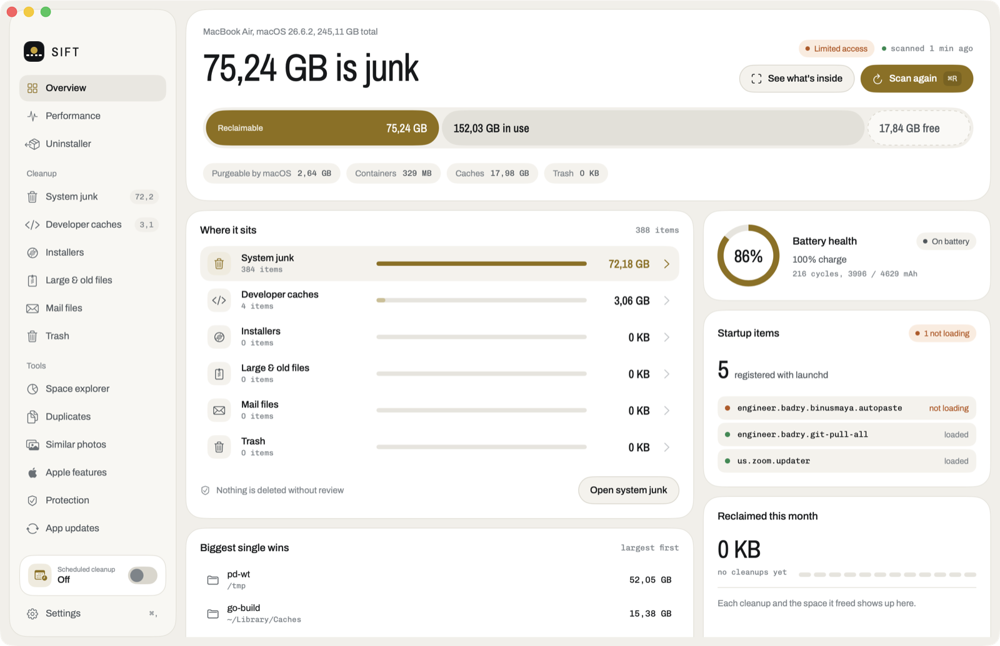
</p>

<p align="center">
  
</p>

<p align="center">
  <b>English</b> |
  <a href="docs/README.ar.md">العربية</a> |
  <a href="docs/README.es.md">Español</a> |
  <a href="docs/README.ja.md">日本語</a> |
  <a href="docs/README.pt-BR.md">Português (Brasil)</a> |
  <a href="docs/README.zh-Hans.md">简体中文</a> |
  <a href="docs/README.zh-Hant.md">繁體中文</a>
</p>

<h1 align="center">Sift</h1>

<p align="center">
  <b>Reclaim your Mac.</b><br>
  Free, open-source Mac care: cleanup, app management, storage exploration, and system checks. No subscription or telemetry.
</p>

<p align="center">
  <a href="https://github.com/BadryansahBangsawan/Sift/releases/latest"></a>
  
  
  
  <a href="LICENSE"></a>
  <a href="https://github.com/BadryansahBangsawan/Sift/releases"></a>
</p>

<p align="center">
  <a href="#install">Install</a> -
  <a href="#why-this-exists">Why this exists</a> -
  <a href="#how-it-compares">How it compares</a> -
  <a href="#our-promise">Our promise</a> -
  <a href="#what-it-does">What it does</a> -
  <a href="#permissions">Permissions</a>
</p>

---

## Coming from PureMac

Sift started as a fork of PureMac, the open-source Mac cleaner by [Moamen Basel](https://github.com/momenbasel), and is now developed independently with a new interface and new tools. It uses its own bundle identifier, `com.sift.app` (PureMac used `com.puremac.app`).

- **Settings and history migrate automatically.** On first launch Sift copies your PureMac preferences and its `~/Library/Application Support/PureMac` folder. The PureMac data is left untouched, so an old copy keeps working until you remove it.
- **Grant Full Disk Access again.** macOS ties the permission to the bundle identifier, so Sift needs its own entry in System Settings > Privacy & Security > Full Disk Access. You can remove the old PureMac entry.
- **The command-line tool is now `sift-cli`.** It is not called `sift` because Homebrew already ships an unrelated `sift` (a grep alternative). It reads `~/.config/sift/` first and falls back to your existing `~/.config/puremac/` settings and protected paths.

## Install

Download `Sift-4.2.1.dmg` from the [latest release](https://github.com/BadryansahBangsawan/Sift/releases/latest) and drag Sift to Applications. From 4.2.0 on, Sift updates itself; 4.1.2 and older need this one manual download.

This release is not notarized by Apple yet, so macOS stops it the first time you open it:

1. Open Sift. macOS says it can't verify the app; click **Done**.
2. Open **System Settings > Privacy & Security**, scroll down and click **Open Anyway** next to Sift, then confirm.
3. Grant **Full Disk Access** when Sift asks. If you used PureMac, add Sift again: the permission belongs to the old bundle identifier.

A Homebrew cask will follow once releases are signed and notarized. Release steps live in [RELEASING.md](RELEASING.md).

### Build from source

```bash
brew install xcodegen
git clone https://github.com/BadryansahBangsawan/Sift.git
cd Sift
xcodegen generate
xcodebuild -project Sift.xcodeproj -scheme Sift -configuration Release \
  -derivedDataPath build build
open build/Build/Products/Release/Sift.app
```

### Command line

Open `sift-cli` for a keyboard-driven workspace. Select individual cache paths,
review project artifacts, or browse your storage by size. Cleanup shows the exact
selection and asks for confirmation before permanently removing it.

```bash
cd cli
swift build -c release
.build/release/sift-cli
```


Use `sift-cli clean dev --dry-run` for a preview or `--json` for scripts. See
[`cli/README.md`](cli/README.md) for controls, commands, and cleanup boundaries.

## How it compares

|  | **Sift** | CleanMyMac | Pearcleaner | Mole | OnyX |
|---|:---:|:---:|:---:|:---:|:---:|
| Price | **Free** | $40+/yr | Free | CLI free / GUI paid | Free |
| Open source | **Yes (MIT)** | No | Source-available¹ | CLI only | No |
| Native Mac GUI | **Yes** | Yes | Yes | Terminal-first | Yes |
| No telemetry | **Yes** | No | Yes | Yes | Yes |
| No subscription | **Yes** | No | Yes | — | Yes |
| Signed + notarized | No (ad-hoc signed) | Yes | Yes | — | Yes |
| App uninstaller + orphans | **Yes** | Yes | Yes | Partial | No |
| App-uninstall Trash support | **Yes** | Partial | Yes | Partial | No |
| Honest about purgeable space | **Yes** | No | n/a | n/a | n/a |

<sub>¹ Pearcleaner is Apache 2.0 **+ Commons Clause** - source-available but not OSI-approved (you may not sell it). Sift is true MIT. Comparison reflects publicly documented features as of 2026.</sub>

## Our promise

A Mac cleaner asks for the deepest permission macOS grants - Full Disk Access - and then deletes your files. That demands a level of trust the category has spent twenty years burning. Here's the contract Sift holds itself to, and you can verify every line of it in the source:

- **Deletion behavior is explicit.** App uninstalls, orphan removal, exact-duplicate removal, project junk, AI chat history, Large & Old Files, Installers and everything a scheduled auto-clean removes use the Trash at user level. Sift never empties the Trash: empty it yourself in Finder. Dashboard/category cleanup of caches and logs, Docker/Xcode runtime cleanup, administrator-authorized removal, local snapshot deletion, and CLI cleanup can permanently delete data. Review selections carefully and use CLI dry runs.
- **No telemetry, ever.** No analytics, no crash reporting, no "anonymous usage stats," no network calls to us. The app doesn't know you exist.
- **No fake urgency.** No dramatized "47 GB of junk detected!" badge, no red alarm counters, no "your Mac is at risk." We show you neutral facts and let you decide.
- **No overpromising.** We don't claim to "reclaim purgeable space," "boost RAM," or "speed up your Mac" - things no app can reliably do. See the purgeable-space note below.
- **Reviewable selection.** Manual cleanup, app-file removal, orphan removal, duplicate removal, and local snapshot deletion require confirmation. Cleanup filters show when selected items are hidden; select-visible controls affect only the rows on screen. Scheduled auto-clean remains unattended once enabled.
- **Auditable.** It's MIT. The exact code that decides what gets removed is in [`Sift/Services`](Sift/Services) and [`Sift/Logic/Scanning`](Sift/Logic/Scanning). Read it. Fork it. Ship your own.

If Sift ever adds telemetry, a paywall on core features, or a fear-based scan, it will have become the thing it was built to replace. Hold us to this.

## Why this exists

Apple sells base-model Macs with 256 GB SSDs that you can't upgrade. The Mac mini, the Air, every entry-level MacBook Pro - the drive is soldered down. The next storage tier costs more than a midrange Windows laptop. Once you've paid it, every gigabyte you've already bought matters.

Most Mac cleaners are subscription apps that hide their disk usage behind a paywall, ship telemetry by default, and trade on FUD ("47 GB of junk detected!"). Sift is the opposite:

- **One-time install.** No subscription, no trial, no account.
- **No telemetry.** It never phones home. It doesn't even know you exist.
- **Open source under MIT.** Read the code, fork it, audit it.
- **Honest scans.** "Junk" means actually-junk: cache directories the OS itself would purge, orphaned files left by apps you've already deleted, broken installer receipts, that 4 GB Xcode DerivedData blob from 2023.
- **Real uninstalls.** Drag an app, see every preference plist, cache folder, container, launch agent and log file it dropped across your library, remove all of it at once.

## What it does

### App Uninstaller
Discovers everything in `/Applications` and `~/Applications`, then uses a 10-level matching engine (bundle ID, team identifier, entitlements, Spotlight metadata, container discovery, company-name heuristics, partial path matches) to find related files on your disk. Matching is heuristic, so review the results before removal. Three sensitivity tiers - Strict, Enhanced, Deep - let you choose how aggressive that match is. Apple system apps are excluded from the uninstall list automatically. You can also right-click any app in Finder and choose **Services → Uninstall with Sift** to jump straight into its related-files scan.

### Orphan Finder
Walks `~/Library` and surfaces files left behind by apps that no longer exist on disk. The matcher compares against bundle identifiers and normalized names of every installed app, so a leftover `~/Library/Containers/com.foo.bar` from an app you deleted in 2022 shows up clearly.

### System Cleaner
Smart Scan checks each category in sequence and reports progress as files are found. You can stop a scan and keep the categories already completed:

- **System Junk** - system caches and logs; `/tmp` entries only when you own them, they have been untouched for three days and hold no repository or socket (never preselected)
- **User Cache** - dynamically discovered, no hardcoded app list
- **AI Tools** - caches and logs of Claude, Claude Code, omp, ChatGPT, Cursor, Codex, Ollama, LM Studio and similar tools; chat and session history and the Claude VM image are listed but never preselected and go to the Trash; memory folders, settings and credentials are never touched
- **Mail Files** - downloaded mail attachments
- **Large & Old Files** - >100 MB or older than 1 year (never auto-selected)
- **Xcode Junk** - DerivedData, Archives, simulator caches, downloaded simulator runtimes (deleted via `simctl runtime delete`; never auto-selected), and XcodeBuildMCP or MobileBuildMCP DerivedData (never auto-selected, so scheduled cleanup leaves it alone; manual cleanup moves it to the Trash while holding the tool's storage lock, which does not detect a running build)
- **Brew Cache** - Homebrew download caches within approved cache locations
- **Node Cache** - npm, yarn classic, pnpm content-addressable store
- **Docker Cache** - images, containers, build cache

### Project Junk

Developer projects pile up dependency folders and build output: `node_modules`, `.venv`, `target`, `.build`, `.next`, `Pods`, `DerivedData` and similar. Choose the folders where you keep code (external drives work) and Sift lists, per project, only the folders it can prove are generated:

- the matching project file sits next to the folder (`package.json` next to `node_modules`, `Cargo.toml` next to `target`, …),
- the folder's contents carry a build signature (`.package-lock.json`, `pyvenv.cfg`, `CACHEDIR.TAG`, …),
- and, inside a git repository, git ignores the folder and tracks nothing in it.

Symbolic links, folders that contain a repository, folders inside hidden tool directories (such as agent worktrees) and your exclusions are left alone, and every row says why it qualified. A folder Sift is unsure about is listed under "Left alone" with the reason instead of being offered. Each folder is checked again right before it moves, and folders go to the Trash. Project Junk is never part of Smart Scan or scheduled cleanup.

> **On "purgeable space":** Sift shows your APFS purgeable space in the storage breakdown for transparency, but it deliberately does **not** list it as junk to delete. Purgeable space is reserved and reclaimed by macOS itself - no third-party app can reliably free it, and even the Finder's purgeable figure is known to be inaccurate. Cleaners that claim to "reclaim purgeable space" are overpromising. We'd rather be honest than impressive.

### Storage and file review

**Apple Features** can turn Apple Intelligence off on Apple silicon with macOS 15.1 or later: pick the features to keep, review every change, and Sift asks macOS's asset service to delete the on-device models and writes a configuration profile you approve in System Settings, which blocks the models from downloading again. Optional switches cover Mac Analytics, personalized ads, Siri and search improvement sharing, Spotlight web results and a few macOS pop-ups; every change can be undone. Storage settings may keep counting the models until macOS deletes them, and a blocked model download can delay a macOS update by about two hours. On other Macs the screen keeps its guidance: instructions for the installed macOS version that open the relevant Settings pane or app.

The **Storage** tab in Apple Features measures known model assets, downloaded screen savers, GarageBand support files, Apple Loops, and local device backups. Missing, inaccessible, and partial results are distinguished. System-managed content is shown for review and is excluded from cleanup totals. Model storage is not promised as recoverable space. See the [Apple controls and storage research](docs/APPLE-FEATURES.md) for sources and version limits.

Local iPhone and iPad backups have a separate manual review. Nothing is preselected or scheduled. Selected backups move to the Trash after confirmation and fresh checks for changes, symbolic links, and exclusions. Keep any backup you may need to restore a device; space is not reclaimed until the Trash is emptied.

**Space Explorer** measures the allocated space inside a folder you choose. Drill into directories, compare their sizes, and reveal an item in Finder. Packages are measured without exposing their contents as navigable folders. Skipped and inaccessible items are reported.

**Duplicate Finder** groups files with matching sizes and SHA-256 content hashes. Hard links are not counted as separate recoverable copies. Every group keeps one protected copy; selected extras move to the Trash only after confirmation and a fresh identity/content check. Emptying the Trash is a separate step.

**Similar Photos** compares image thumbnails using perceptual hashes, color, and aspect ratio. Review likely matches side by side and reveal them in Finder. Similarity is an estimate, so this tool does not remove photos. Each scan checks up to 500 images and 10,000 directory entries, with a visible notice when a limit is reached. Photo libraries, app packages, symbolic links, and cloud-only files are skipped.

Cleanup results support name/path search, size and age filters, sorting, and selection of visible rows. Right-click a cleanup result to always exclude its path. Exclusions also protect containing folders from cleanup and apply to scheduled runs; manage them in Settings.

### Protection and performance

**Protection** checks Gatekeeper, FileVault, the application firewall, System Integrity Protection, and installed XProtect metadata. A failed or unavailable check stays unknown. It also provides shortcuts to privacy and permission settings. This is a configuration audit, not an antivirus or malware scanner.

**Performance** includes a collapsible CPU–Memory card with live app/process usage, app icons, sorting, search and helper grouping. CPU percentages use the Mac’s total capacity; memory shows resident usage, so shared pages can appear in more than one process. Process sampling pauses when the card is closed or the Performance window loses focus. Summary sampling also stops outside the active Performance page unless the menu-bar system monitor is enabled. Startup/background items have their own collapsible card, and local snapshots are listed separately. A launch definition is not proof that a process is running. You can open Login Items or Activity Monitor and delete a specific Time Machine local snapshot after confirmation. Snapshot sizes are not estimated, and system update snapshots cannot be removed here.

### App updates

From 4.2.0 on, Sift updates itself: **Sift → Check for Updates…** or **Settings → Updates** checks the signed appcast, verifies the download's EdDSA signature and offers **Install and Relaunch**. Automatic checks are on by default and can be turned off there. Sift 4.1.2 and older have no updater and need one manual download of the latest version.

Check for updates to Homebrew-managed cask apps and choose which ones to upgrade. Sift runs Homebrew with analytics disabled and shows command failures. These actions use the network and Homebrew's package sources. Apps installed outside Homebrew are not covered; an App Store shortcut is provided for those managed by Apple.

### Scheduled Cleaning
Optional. Choose an interval (weekly runs pick a day and an hour) and an auto-clean threshold, so background runs only fire when there's something meaningful to remove. The rail shows when the next run is due. Opt-in items (AI chat history, large files, `/tmp` entries) and Project Junk are never cleaned on a schedule. What a scheduled clean removes goes to the Trash; rows that cannot (Docker prune, simulator runtimes, root-owned files) wait for your next manual clean.

### Settings

Open **Settings** from the bottom of the sidebar or with ⌘,. It is split into General, Cleaning, Schedule, Appearance, Permissions and Updates: language (13 languages), System/Light/Dark appearance and an accent colour, Full Disk Access status and recheck, startup, the menu-bar monitor, the large-file threshold, exclusions, and the schedule.

The **Updates** tab shows the installed version and build and checks for a newer Sift through the signed appcast. **Install and Relaunch** verifies the EdDSA signature before replacing the app; automatic checks are on by default and can be turned off there. CLI releases, drafts and prereleases are ignored.

## Permissions

Sift needs **Full Disk Access** to read the locations macOS hides from every app by default - Mail downloads, Safari data, the TCC database, protected app containers. Without it, some cleanup categories and app-container scans will be incomplete. The locations available depend on your macOS version and permissions.

The first-launch onboarding walks you through granting it with an animated preview of the exact toggle you need to flip. If you skip it, the dashboard surfaces a single-click "Set up" pill. If a cleanup fails because of a permission issue, Sift opens System Settings, reveals its bundle in Finder so you can drag it into the FDA list, polls the permission state every second, and auto-retries the failed batch the moment you grant access. You never have to re-select anything.

What Sift does *not* do:
- It does not collect telemetry, crash reports, or usage analytics.
- Local scans and cleanup work offline. Checking for or installing a Sift update (4.2.0 and later), or checking for and installing Homebrew app updates, requires a network connection.
- It does not upload or transmit scanned paths or deleted data.

## Troubleshooting

### macOS says it can't verify Sift

Releases are ad-hoc signed and not notarized by Apple yet. The first time you open Sift, click **Done**, then open **System Settings > Privacy & Security**, scroll down and click **Open Anyway** next to Sift. You only do this once per version.

### Launchpad / Dock shows a stale or dull Sift icon

macOS aggressively caches app icons in LaunchServices. After replacing Sift with a newer version the Dock and Launchpad can keep showing the old cached icon. Re-register Sift and restart the Dock (adjust the app path if you installed it elsewhere):

```bash
/System/Library/Frameworks/CoreServices.framework/Versions/A/Frameworks/LaunchServices.framework/Versions/A/Support/lsregister \
  -f "/Applications/Sift.app"
killall Dock
```

Give it a minute to re-seed, then open Sift once. If it still sticks, a restart (or Safe Mode boot) forces a full rebuild.

## Screenshots

| Overview | Dark appearance |
|---|---|
|  |  |

| AI Tools | Project Junk |
|---|---|
| 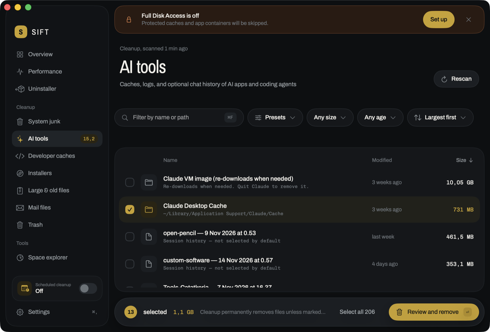 | 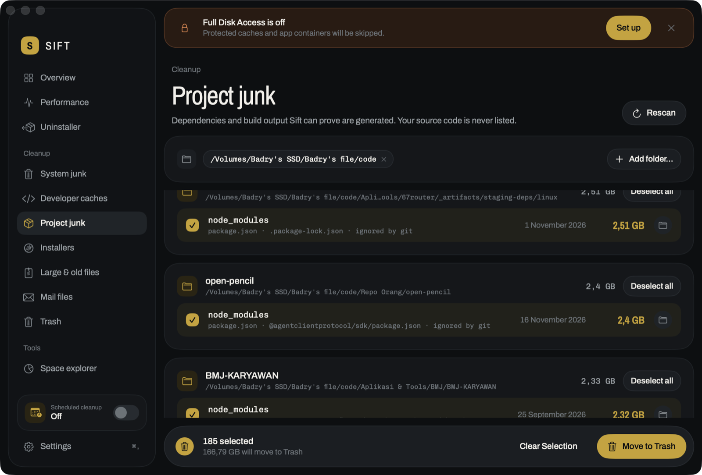 |

| Apple Intelligence | Apple Storage |
|---|---|
| 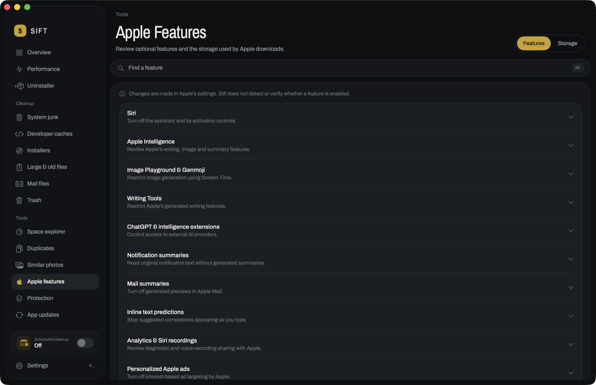 | 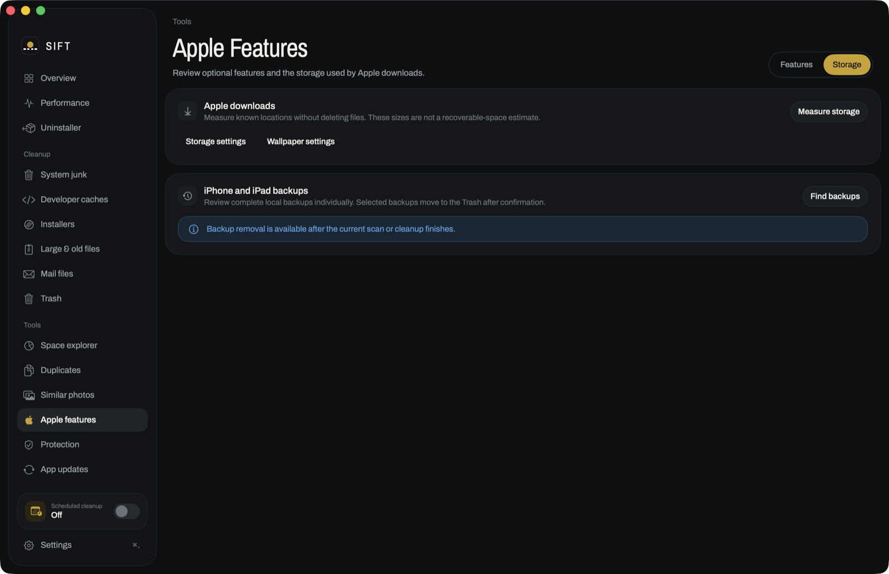 |

| Space Explorer | Duplicate Finder |
|---|---|
| 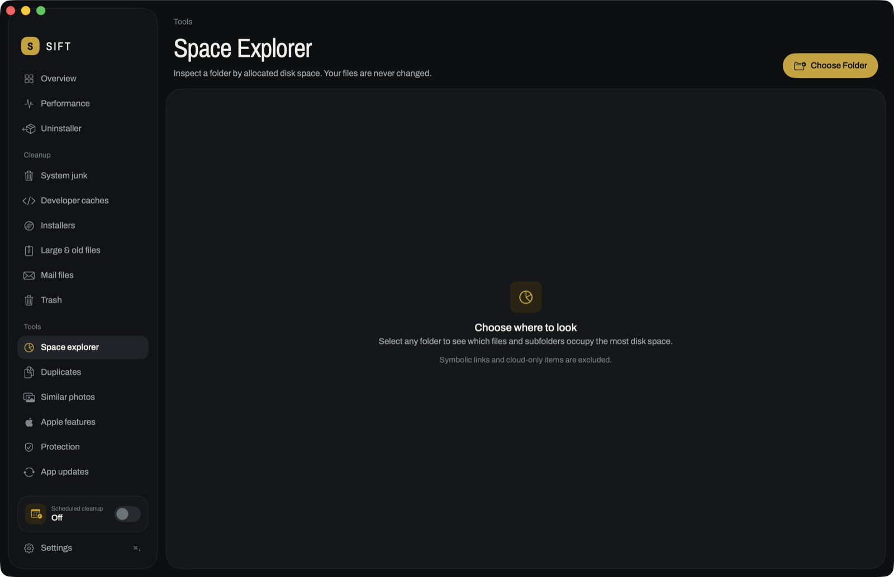 | 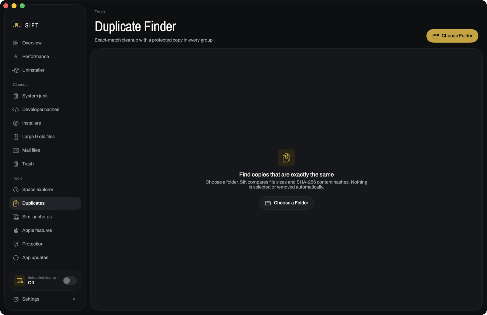 |

| Protection | App Updates |
|---|---|
| 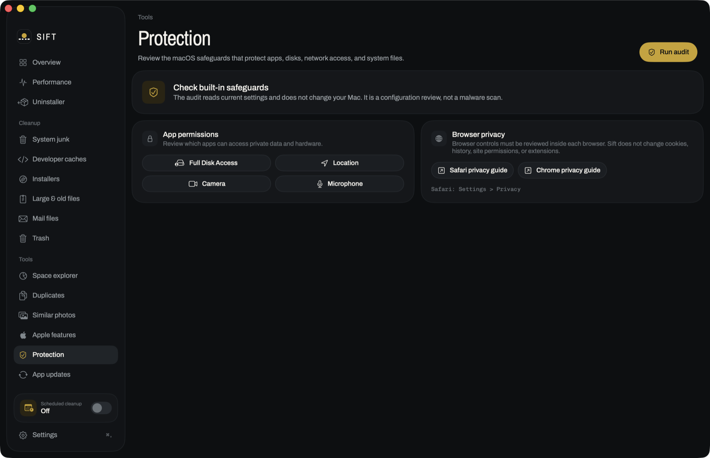 | 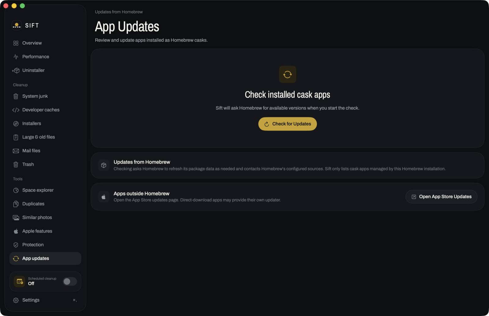 |

| Uninstaller | System Junk |
|---|---|
| 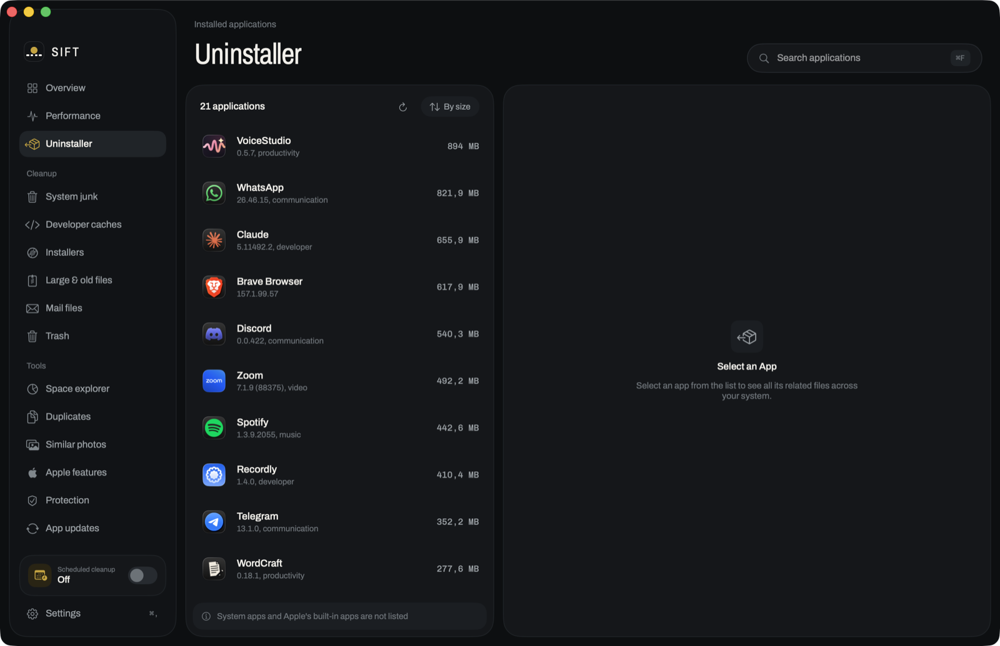 | 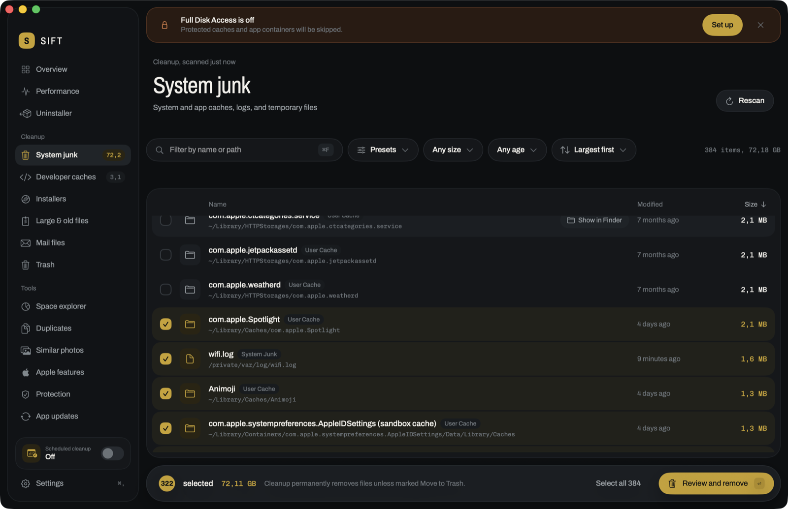 |

Screenshots show the running macOS app on a real Mac.

## Architecture

```
Sift/
  DesignSystem/       - Colours, type, icons and components shared by every screen
  Logic/Scanning/     - Heuristic scan engine, locations database, conditions
  Logic/Utilities/    - Structured logging
  Models/             - Data models, typed errors
  Services/           - Scanning, cleanup, file tools, protection, updates, scheduler
    AppleIntelligence/ - Apple Intelligence catalog, asset service, profile, undo journal
  ViewModels/         - Centralized app state
  Views/              - Native SwiftUI views
    Apps/             - App uninstaller views
    Components/       - Shared components (FDA demo, permission sheet)
    Orphans/          - Orphan finder
    Tools/            - Space, duplicates, similar photos, protection, performance, updates
    Settings/         - Native Form-based settings
```

Key components:
- **AppPathFinder** - 10-level heuristic matching engine for discovering app-related files
- **Locations** - 120+ macOS filesystem search paths
- **Conditions** - 25 per-app matching rules for edge cases (Xcode, Chrome, VS Code, etc.)
- **PermissionCoordinator** - Single source of truth for FDA prompts, polling, and post-grant retries
- **FullDiskAccessManager** - TCC probe + registration; broad probe paths (Mail, Safari, Messages, AddressBook, Calendars) so macOS catalogs the bundle reliably
- **CleaningEngine** - Symlink-resistant deletion with an allow-list, NSAppleScript-based admin escalation for root-owned items, NUL-separated path staging for xargs
- **ProjectJunkFinder** - The single decision point for Project Junk: name, project marker, content signature and git checks, run at scan time and again before a folder moves
- **AIToolCleanupCatalog** - Exact allow-list of AI tool caches and session shapes, plus the paths that are never touched

## Security

- Core-cleaner symlink-risk reduction: `CleaningEngine` resolves paths before validation and again near user-level deletion. Because final removal remains path-based, this narrows but cannot eliminate every TOCTOU race; other removal workflows have separate checks.
- Core-cleaner allow-list: `CleaningEngine` refuses a user-level path outside its explicit safe roots. App-uninstaller and orphan flows use their own policies.
- Admin escalation is gated by its own explicit allow-list; root-owned items outside those permitted roots are refused.
- System app protection: Apple's bundles cannot be uninstalled, regardless of selection.
- Manual destructive workflows require confirmation. Exact duplicates retain one protected copy and recheck files before moving extras to the Trash. Scheduled auto-clean remains unattended after enablement.

If you find a vulnerability, please open a private security advisory rather than a public issue.

## Acknowledgments

- **[PureMac](https://github.com/momenbasel/PureMac)** by Moamen Basel and the PureMac contributors - the cleaner Sift started from (MIT).
- **Om Lahore** - [RemoveMacAI](https://github.com/omlahore/RemoveMacAI), whose Apple Intelligence catalog, asset-service reset and profile design Sift's Apple Intelligence tool is ported from (MIT).
- **4evy** - [pared](https://github.com/4evy/pared), which first mapped Apple's asset service, model sets and settings keys that RemoveMacAI builds on (MIT).

Their licenses are in [LICENSE](LICENSE) and [THIRD-PARTY-NOTICES.md](THIRD-PARTY-NOTICES.md).

## License

MIT. See [LICENSE](LICENSE).
