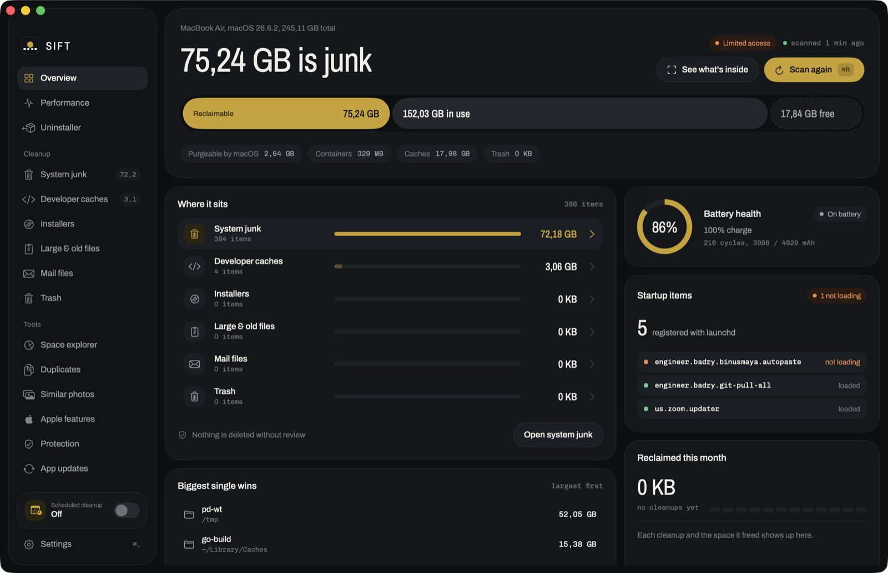

<p align="center">
  
</p>

<p align="center">
  <a href="../README.md">English</a> |
  <a href="README.ar.md">العربية</a> |
  <a href="README.es.md">Español</a> |
  <a href="README.ja.md">日本語</a> |
  <b>Português (Brasil)</b> |
  <a href="README.zh-Hans.md">简体中文</a> |
  <a href="README.zh-Hant.md">繁體中文</a>
</p>

<h1 align="center">Sift</h1>

<p align="center">
  <b>Recupere seu Mac.</b><br>
  Cuidado para Mac gratuito e de código aberto: limpeza, gerenciamento de apps, exploração do armazenamento e verificações do sistema. Sem assinatura e sem telemetria.
</p>

> Este é um resumo. O [README em inglês](../README.md) é a referência completa e atualizada.

## Vindo do PureMac

O Sift começou como um fork do PureMac, o limpador de código aberto de Moamen Basel, e agora é desenvolvido de forma independente. Na primeira abertura ele copia seus ajustes e histórico do PureMac; os dados antigos não são alterados. Conceda de novo o **Acesso Total ao Disco**, porque a permissão pertence ao identificador antigo. A ferramenta de terminal agora se chama `sift-cli`.

## Instalação

Baixe `Sift-4.0.1.dmg` na [versão mais recente](https://github.com/BadryansahBangsawan/Sift/releases/latest) e arraste o Sift para Aplicativos.

Esta versão ainda não é notarizada pela Apple, então o macOS a bloqueia na primeira vez:

1. Abra o Sift. O macOS diz que não pode verificar o app; clique em **OK**.
2. Abra **Ajustes do Sistema > Privacidade e Segurança**, role para baixo e clique em **Abrir Mesmo Assim** ao lado do Sift.
3. Conceda o **Acesso Total ao Disco** quando o Sift pedir.

### Compilar a partir do código-fonte

```bash
brew install xcodegen
git clone https://github.com/BadryansahBangsawan/Sift.git
cd Sift
xcodegen generate
xcodebuild -project Sift.xcodeproj -scheme Sift -configuration Release \
  -derivedDataPath build build
open build/Build/Products/Release/Sift.app
```

### Linha de comando

```bash
cd cli
swift build -c release
.build/release/sift-cli
```

## O que ele faz

- **Visão geral**: medidor de armazenamento, onde está o lixo, os maiores ganhos, bateria e itens de inicialização.
- **Limpeza**: lixo do sistema, ferramentas de IA, caches de desenvolvimento, instaladores, arquivos grandes e antigos, arquivos do Mail e Lixo, com filtros, exclusões e uma revisão antes de remover qualquer coisa.
- **Ferramentas de IA**: caches e logs do Claude, Claude Code, ChatGPT, Cursor, Ollama e semelhantes. O histórico de conversas e sessões aparece, mas nunca é pré-selecionado e vai para o Lixo; pastas de memória, ajustes e credenciais nunca são tocados.
- **Lixo de projetos**: `node_modules`, `.venv`, `target`, `.build` e pastas semelhantes nas pastas de projetos que você escolher, só quando o Sift consegue provar que são geradas e o git as ignora. Vão para o Lixo e nunca entram na limpeza agendada.
- **Apple Intelligence**: desative recurso por recurso, apague os modelos no dispositivo e bloqueie o download com um perfil que você aprova. Cada alteração é revisada antes e pode ser desfeita (Apple silicon, macOS 15.1 ou posterior).
- **Desinstalador e sobras**: encontra os arquivos relacionados de um app e as sobras de apps removidos; revise e mova para o Lixo.
- **Explorador de espaço, duplicados e fotos semelhantes**, **Proteção** e **Desempenho**.
- **Limpeza agendada** (semanal com dia e hora), 13 idiomas, aparência clara/escura e cor de destaque.

## Privacidade e segurança

Sem telemetria, análises ou relatórios de falhas. As verificações são locais e funcionam offline. Tudo é revisado antes de ser removido; algumas limpezas (categorias e limpeza agendada) apagam de forma permanente, então leia a confirmação. O Sift precisa do **Acesso Total ao Disco** para verificar locais protegidos; a configuração inicial guia você.

## Créditos

Baseado no [PureMac](https://github.com/momenbasel/PureMac) de Moamen Basel e seus colaboradores. A ferramenta de Apple Intelligence foi portada do [RemoveMacAI](https://github.com/omlahore/RemoveMacAI) de Om Lahore, que se baseia no [pared](https://github.com/4evy/pared) de 4evy. Todos sob a licença MIT; veja [THIRD-PARTY-NOTICES.md](../THIRD-PARTY-NOTICES.md).

## Licença

MIT. Veja [LICENSE](../LICENSE).
